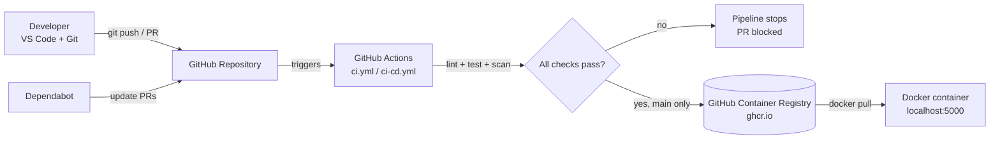
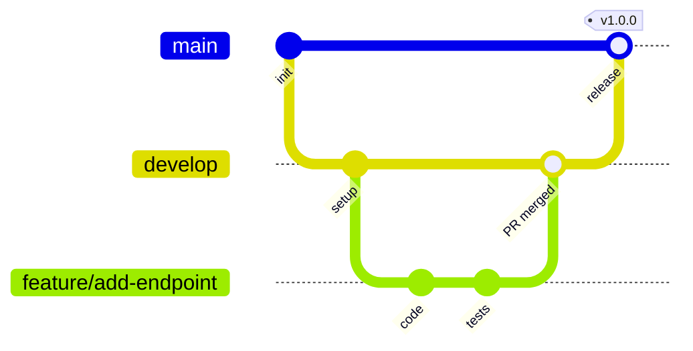
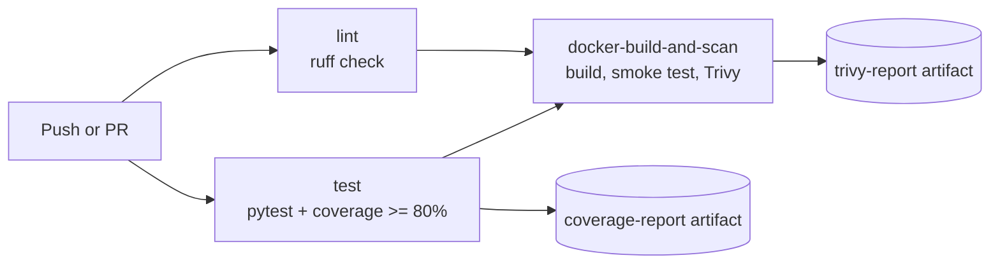
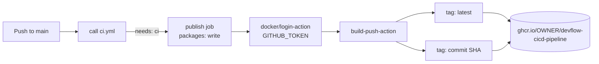
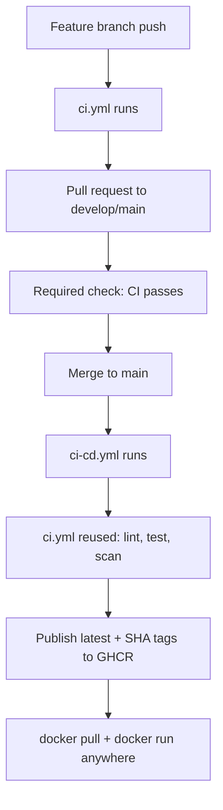
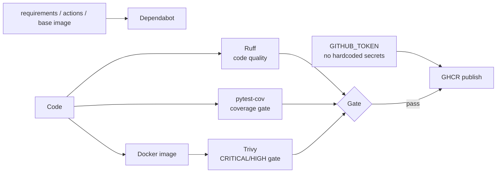

# DevFlow Architecture

All diagrams use [Mermaid](https://mermaid.js.org/), which GitHub renders automatically in Markdown.

## 1. Overall architecture

| Component | Responsibility |
|---|---|
| Developer machine | Write code, run tests locally, commit and push |
| GitHub repo | Stores code, branches, pull requests, branch protection |
| GitHub Actions | Runs automated pipelines on GitHub-hosted runners |
| GHCR | Stores versioned Docker images |
| Dependabot | Opens PRs for outdated dependencies |

## 2. Git branching workflow

- `main`: stable, production-ready. Merges here publish the image.
- `develop`: integration branch.
- `feature/*`, `bugfix/*`: short-lived branches; merged through pull requests.

## 3. CI pipeline (ci.yml)

`lint` and `test` run in parallel. `docker-build-and-scan` uses `needs: [lint, test]`, so it only starts if both succeed.

## 4. Docker build and publish (ci-cd.yml)

## 5. Complete CI/CD pipeline

Duplicate-run prevention: `ci.yml` ignores pushes to `main`; on `main`, `ci-cd.yml` calls `ci.yml` once through `workflow_call`.

## 6. DevSecOps integration

Security controls: least-privilege `permissions`, `packages: write` only in the publish job, non-root container user, no secrets in the repo, publish never runs on pull requests.
